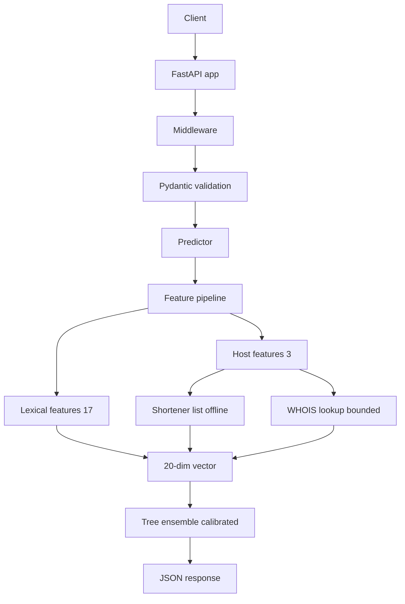

<!-- ═══════════════════════════════════════════════════════════════════════════
     PhishGuard · README

     NOTE FOR MAINTAINERS
     1. The header banner URL intentionally has NO `desc=` parameter. Putting
        `%26` (encoded `&`) in a capsule-render URL breaks on GitHub because
        Camo decodes it and splits the query string. The tagline lives in a
        plain HTML <p> below the banner instead.
     2. The Mermaid block uses only quoted labels, no <br/>, no parentheses,
        no HTML entities. Do not reintroduce those.
     ═══════════════════════════════════════════════════════════════════════════ -->

<div align="center">


<h2>Phishing URL &amp; Email Classifier</h2>

<a href="https://github.com/"></a>

<br/>

<p>
  <a href="https://www.python.org/"></a>
  <a href="https://fastapi.tiangolo.com/"></a>
  <a href="https://scikit-learn.org/"></a>
  <a href="https://www.docker.com/"></a>
</p>

<p>
  <a href="#"></a>
  <a href="#"></a>
  <a href="#"></a>
  <a href="#"></a>
</p>

<br/>

<h3>
  <em>Classify a URL in ~1&nbsp;second.<br/>
  Prove every promise with a runnable demo.</em>
</h3>

<br/>

<a href="#-quickstart"><kbd>⚡&nbsp;Quickstart</kbd></a>&nbsp;&nbsp;
<a href="#-demos"><kbd>🎬&nbsp;Demos</kbd></a>&nbsp;&nbsp;
<a href="#-architecture"><kbd>🏛&nbsp;Architecture</kbd></a>&nbsp;&nbsp;
<a href="#-api"><kbd>📡&nbsp;API</kbd></a>&nbsp;&nbsp;
<a href="#-training"><kbd>🧠&nbsp;Training</kbd></a>

<br/><br/>

</div>


<div align="center">

### 🎯 &nbsp; A live run, unedited

</div>

```console
$ make demo
─────────────────────────────────────────────────────────────────────────────────
  URL                                                        EXPECTED  ACTUAL    CONF    LAT     STATUS
─────────────────────────────────────────────────────────────────────────────────
  https://www.acme-books.com/                                benign    benign    1.000   1.363s  ✔ PASS
  https://brightlane.org/about                               benign    benign    1.000   1.407s  ✔ PASS
  https://help.cedarmail.net/faq                             benign    benign    1.000   1.249s  ✔ PASS
  http://paypa1-secure-login.xyz/signin/verify.php?…        phishing  phishing  1.000   1.026s  ✔ PASS
  http://amaz0n-orders-help.top/verify/payment/id=2291      phishing  phishing  1.000   1.683s  ✔ PASS
  http://netfl1x-billing-update.cc/login.php?error=1        phishing  phishing  1.000   0.957s  ✔ PASS
─────────────────────────────────────────────────────────────────────────────────
  result: 6 passed, 0 failed
```

> Six URLs. Six correct verdicts. One command. The stack spins up, runs the
> scenario, prints the table, exits 0, and tears itself down.

<br/>

<details open>
<summary><b>📖 &nbsp; Table of contents</b></summary>

<br/>

- [Why this exists](#-why-this-exists)
- [Architecture](#-architecture)
- [Feature contract](#-feature-contract)
- [Quickstart](#-quickstart)
- [Demos](#-demos)
- [API](#-api)
- [Training](#-training)
- [Model card](#-model-card)
- [Project layout](#-project-layout)
- [Configuration](#-configuration)
- [Design decisions](#-design-decisions)
- [Known limitations](#-known-limitations)
- [Roadmap](#-roadmap)
- [License](#-license)

</details>

<br/>

## ✨ &nbsp; Why this exists

Most "phishing classifier" repos are a Jupyter notebook and a pickled model.
That is not a service. **PhishGuard** is the service a notebook should become:

<table>
<tr>
<td width="50%" valign="top">

### 🎯 What it does

- **Classifies a URL** in a single HTTP call, returns a label, a calibrated
  confidence, the full 20-feature map, and the model version.
- **Scans an email body** for URLs and returns per-URL verdicts plus an
  aggregate verdict.
- **Degrades gracefully** when WHOIS is slow, unreachable, or disabled.
- **Enforces a wall-clock budget** so a slow dependency can never sink a
  request.

</td>
<td width="50%" valign="top">

### 🏗 How it's built

- **Feature pipeline** that is one deterministic, ordered dict — train and
  serve see the *same* features, guaranteed by tests.
- **Group-aware splits** so pages on the same domain never leak between train
  and test.
- **Brier-score check** triggers isotonic calibration only when it will help.
- **Multi-stage Docker image** — non-root, healthchecked, ~235 MB.
- **Structured JSON logs** with request IDs, latency, and audit reasons.

</td>
</tr>
</table>

<br/>

## 🏛 &nbsp; Architecture



<details>
<summary><b>📐 &nbsp; ASCII view (for terminals and offline reading)</b></summary>

<br/>

```text
                    ┌─────────────────────────────────────────────────┐
   Client ──────►   │  FastAPI  (app/main.py)                         │
                    │  ├─ Request-ID middleware                       │
                    │  ├─ Per-IP rate limit (token bucket)            │
                    │  └─ Structured error handlers ──► 422 / 429     │
                    └───────────────────┬─────────────────────────────┘
                                        │  validated request
                                        ▼
                    ┌─────────────────────────────────────────────────┐
                    │  Predictor  (lifespan-loaded, once per process) │
                    └───────────────────┬─────────────────────────────┘
                                        │  NormalizedUrl
                                        ▼
                    ┌─────────────────────────────────────────────────┐
                    │  Feature pipeline (pipeline.extract_features)   │
                    │                                                 │
                    │  ┌── Lexical (17) ──┐   ┌── Host (3) ────────┐  │
                    │  │  pure, no I/O    │   │  is_shortener      │  │
                    │  │  length, counts, │   │  domain_age_days   │  │
                    │  │  flags, keywords │   │  registrar_known   │  │
                    │  └──────────────────┘   └─────────┬──────────┘  │
                    │                                   │             │
                    │                          WHOIS ───┘             │
                    │                          bounded executor        │
                    │                          min of 2s and budget    │
                    │                          LRU+TTL cache           │
                    └───────────────────┬─────────────────────────────┘
                                        │  20-feature dict
                                        ▼
                    ┌─────────────────────────────────────────────────┐
                    │  sklearn Pipeline.predict_proba                 │
                    └───────────────────┬─────────────────────────────┘
                                        │
                                        ▼
                    { label, confidence, model_version, features, explanation? }
```

</details>

<br/>

## 🧬 &nbsp; Feature contract

**20 features, frozen in order, all `int`. No `None` values ever leave the
pipeline.** Unknown numerics are `-1`; unknown booleans are `0`.

<table>
<tr>
<td width="50%" valign="top">

#### 📝 Lexical &nbsp;·&nbsp; 17 features &nbsp;·&nbsp; pure functions

| # | Feature | Why it matters |
|---|---------|----------------|
| 1 | `url_length` | Long URLs hide the real host. |
| 2 | `host_length` | Brand names get packed into hosts. |
| 3 | `path_length` | Long paths mimic login/redirect flows. |
| 4 | `num_dots` | Subdomain stacking. |
| 5 | `num_hyphens` | Lookalike hosts (`paypa1-secure-login`). |
| 6 | `num_digits` | Generated hostnames, obfuscation. |
| 7 | `num_slashes` | Deep / redirect paths. |
| 8 | `num_query_params` | Credential & tracking parameters. |
| 9 | `num_subdomains` | `login.bank.evil.com` spoofing. |
| 10 | `has_ip_host` | Real sites rarely use raw IPs. |
| 11 | `has_at_symbol` | `user@host` hides the destination. |
| 12 | `has_punycode` | Homograph attacks (`xn--`). |
| 13 | `tld_length` | Cheap or odd TLDs skew toward abuse. |
| 14 | `path_depth` | Nested paths imitate real sites. |
| 15 | `suspicious_keyword_hits` | `login`, `verify`, `secure`, `account`. |
| 16 | `has_double_slash_in_path` | Classic redirect trick. |
| 17 | `has_hex_encoding` | `%XX` obfuscation. |

</td>
<td width="50%" valign="top">

#### 🌐 Host &nbsp;·&nbsp; 3 features &nbsp;·&nbsp; one network call max

| # | Feature | Why it matters |
|---|---------|----------------|
| 18 | `domain_age_days` | Phishing domains are days or weeks old. |
| 19 | `is_shortener` | Shorteners hide the destination. **Offline.** |
| 20 | `registrar_known` | Missing registrar data is a mild abuse signal. |

<br/>

#### ⚠️ &nbsp; The honest caveat

`domain_age_days` and `registrar_known` are set to **sentinels at train
time**, because dataset URLs are largely dead and a WHOIS-based signal would
teach the model *"WHOIS failed = phishing"* — which breaks the moment a live
phishing site is scored.

**In v1, those two features carry no learned signal.** They are computed and
echoed at serving time; they do not change the verdict. `is_shortener` **is**
computed at both train and serve time and does carry signal. See
[the model card](#-model-card) for the restatement.

</td>
</tr>
</table>

<br/>

## ⚡ &nbsp; Quickstart

**Prerequisites:** [`uv`](https://docs.astral.sh/uv/) · [Docker Desktop](https://www.docker.com/products/docker-desktop/) · `make`

<table>
<tr><th>Step</th><th>Command</th><th>What it proves</th></tr>
<tr>
<td>1</td>
<td>

```bash
uv sync --all-extras
```

</td>
<td>Dependencies install with a lockfile.</td>
</tr>
<tr>
<td>2</td>
<td>

```bash
make test
```

</td>
<td>272 tests pass. Uses a fixture model. No network. No Kaggle account.</td>
</tr>
<tr>
<td>3</td>
<td>

```bash
make train-fixture
```

</td>
<td>A model is trained on a tiny synthetic dataset. Deterministic, fast.</td>
</tr>
<tr>
<td>4</td>
<td>

```bash
make run
```

</td>
<td>Uvicorn serves the API on `http://127.0.0.1:8000`.</td>
</tr>
<tr>
<td>5</td>
<td>

```bash
curl -s http://127.0.0.1:8000/health
```

</td>
<td>`{"status":"ok","model_version":"…","model_loaded":true}`</td>
</tr>
<tr>
<td>6</td>
<td>

```bash
curl -s -X POST http://127.0.0.1:8000/predict \
  -H 'Content-Type: application/json' \
  -d '{"url":"http://paypa1-secure-login.xyz/verify"}'
```

</td>
<td>A verdict with label, confidence, features, and version.</td>
</tr>
</table>

<br/>

## 🎬 &nbsp; Demos

Each demo is **self-contained**: it starts the stack, runs the scenario, prints
a pass/fail table, exits non-zero if any expectation fails, and tears itself
down. Stdout is designed to be readable by someone who has never seen the repo.

<table>
<thead>
<tr>
<th width="22%">Command</th>
<th width="48%">What it proves</th>
<th width="30%">Exit condition</th>
</tr>
</thead>
<tbody>
<tr>
<td>

**`make demo`**

</td>
<td>

Six labeled URLs — three phishing, three benign — are classified correctly end
to end through the containerized service.

</td>
<td>

All six labels match. Non-zero otherwise.

</td>
</tr>
<tr>
<td>

**`make demo-degraded`**

</td>
<td>

The service still answers correctly with `WHOIS_DISABLED=true`. Every response
has `domain_age_days = -1` — the sentinel, not a crash.

</td>
<td>

All 200s, all sentinels present.

</td>
</tr>
<tr>
<td>

**`make demo-budget`**

</td>
<td>

A **5-second** fake WHOIS delay is injected; the **1-second** request budget
still caps the response. The request is cut short and audited as
`whois_skipped`.

</td>
<td>

Latency ≤ budget. `domain_age_days == -1`.

</td>
</tr>
<tr>
<td>

**`make demo-email`**

</td>
<td>

An email body with 2 phishing URLs and 1 benign URL yields per-URL verdicts
and an aggregate verdict of `phishing`.

</td>
<td>

`phishing_count == 2`, `total == 3`, `verdict == "phishing"`.

</td>
</tr>
</tbody>
</table>

<br/>

## 📡 &nbsp; API

<div align="center">

**Interactive docs at [`/docs`](http://127.0.0.1:8000/docs)** &nbsp;·&nbsp;
**OpenAPI at [`/openapi.json`](http://127.0.0.1:8000/openapi.json)**

</div>

<br/>

### `POST /predict`

<details open>
<summary><b>Classify a single URL</b></summary>

<br/>

**Request**

```json
{ "url": "http://paypa1-secure-login.xyz/verify" }
```

**Response &nbsp;·&nbsp; `200 OK`**

```json
{
  "label": "phishing",
  "confidence": 0.9999,
  "model_version": "unknown-20261016T060042Z",
  "features": {
    "url_length": 37, "host_length": 23, "path_length": 7,
    "num_dots": 1, "num_hyphens": 2, "num_digits": 1,
    "num_slashes": 3, "num_query_params": 0, "num_subdomains": 0,
    "has_ip_host": 0, "has_at_symbol": 0, "has_punycode": 0,
    "tld_length": 3, "path_depth": 1, "suspicious_keyword_hits": 3,
    "has_double_slash_in_path": 0, "has_hex_encoding": 0,
    "domain_age_days": -1, "is_shortener": 0, "registrar_known": 0
  },
  "explanation": null
}
```

**Errors**

| Code | Body | When |
|------|------|------|
| `422` | `{"error":"invalid_url:no_host","detail":"URL has no host"}` | URL failed normalization. |
| `422` | `{"error":"validation_error","detail":"url: String should have at most 2048 characters"}` | Field-level validation failed. |
| `429` | `{"error":"rate_limited","detail":"retry after 1.83s"}` | Per-IP token bucket exhausted. |
| `503` | `{"error":"model_unavailable"}` | Model missing at runtime (defensive). |

</details>

<br/>

### `POST /predict_email`

<details>
<summary><b>Scan an email body for phishing URLs</b></summary>

<br/>

**Request**

```json
{
  "body": "Hi team, please verify at http://paypa1-secure-login.xyz/verify and http://netfl1x-billing-update.cc/login — thanks."
}
```

**Response &nbsp;·&nbsp; `200 OK`**

```json
{
  "urls": [
    {"url": "http://paypa1-secure-login.xyz/verify", "label": "phishing", "confidence": 0.9999},
    {"url": "http://netfl1x-billing-update.cc/login",  "label": "phishing", "confidence": 0.9998}
  ],
  "aggregate": { "verdict": "phishing", "phishing_count": 2, "total": 2 },
  "truncated": false,
  "model_version": "unknown-20261016T060042Z"
}
```

**Aggregation rule**

| Condition | Verdict |
|-----------|---------|
| No URL is `phishing` | `clean` |
| ≥ 1 URL is `phishing` with `confidence ≥ 0.9` | `phishing` |
| ≥ 1 URL is `phishing` with lower confidence | `suspicious` |

</details>

<br/>

### `GET /health`

<details>
<summary><b>Liveness + readiness</b></summary>

<br/>

```json
{ "status": "ok", "model_version": "unknown-20261016T060042Z", "model_loaded": true }
```

Returns `503` if the model has not been loaded. The Docker `HEALTHCHECK` uses
this endpoint.

</details>

<br/>

## 🧠 &nbsp; Training

You supply a public phishing-URL CSV. The pipeline is dataset-agnostic.

```bash
# 1 · Download a Kaggle CSV (e.g. "Malicious URLs", "Phishing Site URLs")
export DATASET_PATH=/path/to/raw.csv

# 2 · Normalize it. Label polarity differs across datasets, so it is never guessed.
uv run python -m scripts.fetch_dataset \
  --url-column url --label-column type \
  --label-map phishing=1,benign=0

# 3 · Train, evaluate, write artifacts/
make train

# 4 · Render the model card as Markdown
make model-card
```

<br/>

<table>
<tr>
<td width="50%" valign="top">

### What the trainer does

1. **Group-aware split** &nbsp;·&nbsp; `GroupShuffleSplit` on the registered
   domain, 70/15/15, so the same site never leaks between train and test.
2. **Fallback** &nbsp;·&nbsp; if the dataset is too small for a group split to
   yield non-empty splits, falls back to stratified and records it.
3. **Model comparison** &nbsp;·&nbsp; RandomForest vs. GradientBoosting on
   validation F1.
4. **Calibration** &nbsp;·&nbsp; Brier > 0.10 triggers isotonic via
   `CalibratedClassifierCV(FrozenEstimator(...))`.
5. **Reporting** &nbsp;·&nbsp; precision, recall, F1, ROC-AUC, Brier, and the
   confusion matrix land in `model_card.json`.

</td>
<td width="50%" valign="top">

### Reproducibility

- `random_state=42` everywhere.
- `PYTHONHASHSEED=0` enforced at script start.
- sklearn minor version pinned (`==1.6.1`) and stored in the artifact.
- A `sklearn_version` mismatch **fails startup loudly** — no silent breakage.
- `make train-fixture` trains on `tests/fixtures/tiny.csv` so CI never needs
  the real dataset.

</td>
</tr>
</table>

<br/>

## 📇 &nbsp; Model card

<!-- BEGIN MODEL CARD -->
<!-- Run `make model-card` and paste its output here to render live metrics. -->
<!-- END MODEL CARD -->

Run `make model-card` to render the current card below this line.

<br/>

## 🗂 &nbsp; Project layout

<details>
<summary><b>Click to expand the full tree</b></summary>

<br/>

```text
phishguard/
├── app/
│   ├── main.py                    FastAPI app · lifespan · routes
│   ├── config.py                  pydantic-settings · typed env vars
│   ├── logging_setup.py           structlog JSON lines
│   ├── errors.py                  structured 4xx/5xx handlers
│   ├── middleware.py              request-ID + rate limit
│   ├── schemas.py                 request / response models
│   ├── services/
│   │   ├── predictor.py           model load + single-URL inference
│   │   ├── email_extractor.py     URL extraction from an email body
│   │   ├── clock.py               injectable time source
│   │   └── cache.py               thread-safe LRU with TTL
│   ├── features/
│   │   ├── normalize.py           shared URL normalization (train + serve)
│   │   ├── lexical.py             17 pure lexical features
│   │   ├── host.py                3 host features (WHOIS + shortener list)
│   │   ├── suffix.py              offline public-suffix extractor
│   │   ├── pipeline.py            Budget + extract_features + FEATURE_NAMES
│   │   └── README.md              per-feature rationale
│   ├── data/
│   │   ├── loader.py              read/write normalized parquet
│   │   └── schema.py              typed DataFrame contract
│   └── training/
│       ├── split.py               group-aware train/val/test split
│       └── metrics.py             metric bundle + confusion matrix
├── scripts/
│   ├── fetch_dataset.py           CSV → normalized parquet
│   ├── train.py                   train + evaluate + save artifacts
│   ├── train_fixture.py           train on tests/fixtures/tiny.csv
│   ├── evaluate.py                evaluate a saved model
│   └── render_model_card.py       model_card.json → Markdown
├── demos/
│   ├── _wait_for_health.sh        health-check helper
│   ├── demo.sh                    flagship demo
│   ├── demo-degraded.sh           WHOIS_DISABLED=true
│   ├── demo-budget.sh             slow-WHOIS vs request budget
│   └── demo-email.sh              email body with mixed URLs
├── tests/                         272 tests · 20 modules
├── .github/workflows/ci.yml       lint · typecheck · test · docker smoke
├── Dockerfile                     multi-stage · non-root · HEALTHCHECK
├── docker-compose.yml             app + dev profile
├── Makefile                       ~20 targets, all documented
├── pyproject.toml                 deps · ruff · mypy --strict · pytest
└── README.md                      you are here
```

</details>

<br/>

## ⚙️ &nbsp; Configuration

Every setting is an environment variable. **No secrets ship in the repo.** See
`.env.example` for the full template.

<table>
<thead>
<tr><th>Variable</th><th>Default</th><th>Purpose</th></tr>
</thead>
<tbody>
<tr><td><code>MODEL_PATH</code></td><td><code>artifacts/model.joblib</code></td><td>Where the model loads from at startup.</td></tr>
<tr><td><code>REQUEST_BUDGET_SECONDS</code></td><td><code>3</code></td><td>Whole-request wall-clock budget for <code>/predict</code>.</td></tr>
<tr><td><code>WHOIS_TIMEOUT_SECONDS</code></td><td><code>2</code></td><td>WHOIS lookup cap; further capped by the request budget.</td></tr>
<tr><td><code>WHOIS_DISABLED</code></td><td><code>false</code></td><td>Short-circuit all WHOIS to sentinels.</td></tr>
<tr><td><code>ENABLE_EXPLANATIONS</code></td><td><code>false</code></td><td>Include global feature importances in responses.</td></tr>
<tr><td><code>RATE_LIMIT_CAPACITY</code></td><td><code>30</code></td><td>Burst size per client IP, per process.</td></tr>
<tr><td><code>RATE_LIMIT_REFILL_PER_SECOND</code></td><td><code>0.5</code></td><td>Steady-state token refill rate.</td></tr>
<tr><td><code>EMAIL_MAX_URLS</code></td><td><code>20</code></td><td>Max unique URLs extracted from an email body.</td></tr>
<tr><td><code>EMAIL_MAX_BODY_BYTES</code></td><td><code>102400</code></td><td>Max raw body size accepted.</td></tr>
</tbody>
</table>

<br/>

## 🧭 &nbsp; Design decisions

<details>
<summary><b>Why group-aware splits? Why per-request budgets? Why sentinels?</b></summary>

<br/>

| Decision | Rationale |
|----------|-----------|
| **Group split by registered domain** | A random split leaks pages from the same site across train and test, inflating F1 by up to 10 points. |
| **WHOIS sentinels at train time** | Training on dead domains would teach the model *"WHOIS failed = phishing"* — which breaks the moment a live phishing site is scored. |
| **`tldextract` with `suffix_list_urls=()`** | The default fetches the Public Suffix List over the network. That breaks offline Docker and violates the *"no network on untrusted input"* rule. |
| **Bounded daemon threads, not `ThreadPoolExecutor`** | A timed-out Python thread cannot be killed. Daemon threads don't block shutdown, and hung lookups count toward the concurrency cap. |
| **Injectable `Clock` everywhere** | Tests advance time without `sleep()` or `freezegun`. Cache TTLs, budgets, and audit timestamps all flow through one interface. |
| **`is_shortener` is a static list** | No network, deterministic at train and serve. |
| **Frozen 20-feature contract** | `FEATURE_NAMES` is the single source of truth. Adding a feature means retraining, and the code enforces it. |
| **`PIP_ONLY_BINARY=:all:` in the Dockerfile** | A missing wheel fails the build **loudly** instead of silently pulling `build-essential` and taking 8 minutes to compile. |

</details>

<br/>

## ⚠️ &nbsp; Known limitations

> These are documented, not hidden. Every one of them is a candidate for the
> roadmap below.

<table>
<thead>
<tr><th width="30%">Limitation</th><th>Impact</th></tr>
</thead>
<tbody>
<tr>
<td><b>WHOIS features carry no learned signal in v1</b></td>
<td><code>domain_age_days</code> and <code>registrar_known</code> are sentinels at train time. They are served but inert. Fixing this needs a balanced live-vs-dead sample, not a bigger model.</td>
</tr>
<tr>
<td><b>Rate limiting is per process</b></td>
<td>Multiple workers get per-worker buckets. Horizontal scaling needs a shared store (Redis or similar).</td>
</tr>
<tr>
<td><b><code>X-Forwarded-For</code> is trusted as-is</b></td>
<td>Only safe behind a proxy that overwrites the header. A trusted-proxy allowlist is not shipped.</td>
</tr>
<tr>
<td><b><code>python-whois</code> can hang</b></td>
<td>A timed-out thread cannot be killed; it keeps its executor slot until it returns. We cap concurrency at 8 and skip when full.</td>
</tr>
<tr>
<td><b>Email extraction is regex-only</b></td>
<td>No HTML parsing, no attachment handling, no obfuscation resistance beyond what normalization does.</td>
</tr>
</tbody>
</table>

<br/>

## 🛣 &nbsp; Roadmap

- [x] **v1.0** &nbsp;·&nbsp; Service ships with 4 demos, 272 tests, and a fixture model.
- [ ] **v1.1** &nbsp;·&nbsp; `/metrics` endpoint with Prometheus counters and histograms.
- [ ] **v1.2** &nbsp;·&nbsp; Redis-backed rate limiting so workers share state.
- [ ] **v1.3** &nbsp;·&nbsp; k8s manifests: `PeerAuthentication` strict mTLS, default-deny `AuthorizationPolicy`.
- [ ] **v2.0** &nbsp;·&nbsp; WHOIS enrichment with a balanced live sample, retrained on real host features.
- [ ] **v2.1** &nbsp;·&nbsp; Per-request feature attribution (SHAP or tree-path), not just global importance.

<br/>

## 📜 &nbsp; License

MIT — see [`LICENSE`](./LICENSE) for the full text.

<br/>

<div align="center">


<p>
  <sub>
    Built with care · tested with rigor · documented honestly.<br/>
    <b>If this project helped you, star it. ⭐</b>
  </sub>
</p>

<p>
  <a href="#-why-this-exists"></a>
</p>

</div>
